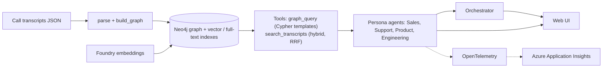

# Transcript Intelligence

An agentic AI assistant for **Aegis Cloud Security** (a fictional B2B SaaS company) The company captures call transcripts
from across the organization — customer support calls (customers reaching out with issues),
external calls (account managers speaking with customers about renewals, adoption, and
feedback), and internal calls (engineering syncs, cross-team escalations, planning discussions).
The team is building a product called Transcript Intelligence — a tool that helps different
stakeholders across the company make better decisions using these transcripts. Think support
leaders, sales managers, product managers, engineering leads — each would want something
different from this tool.

- **Microsoft Foundry** hosts the models; **Microsoft Agent Framework** runs the agents.
- **Neo4j** holds a knowledge graph of the calls plus vector and full-text indexes (hybrid search).
- An **eval harness** compares the graph agent against a vector-only baseline on 18 checks.
- A **local web UI** (persona picker + chat) and **Azure Application Insights** tracing sit on top.


## How it works



**Two tools, deliberately simple.** The model never writes Cypher.
- `graph_query` runs one of 13 vetted, parameterised Cypher templates for lists, counts, rankings and timelines ("who has / hasn't...", "which account improved most", "customer-reported outage durations").
- `search_transcripts` runs vector search and keyword search, merges them with reciprocal rank fusion, and returns passages with a citation. It can filter by account, call type and date.

**Grounding rules** (`src/ti/agent_base.py`) are shared by every persona and by the baseline: every claim must come from a tool result; cite (call title, date); show conflicting figures with who said what; say when evidence is missing; and say that counts are lower bounds because transcripts are excerpts.

**The data:** 100 calls (43 external, 30 internal, 27 support) from 2026-02-03 to 2026-04-28, 32 customer accounts, 879 transcript chunks. Transcripts are excerpts covering a median of about 29% of each call. Contract value (ARR) is not in the data, and the agents say so rather than guess.

## Quick start (Windows PowerShell, Python 3.10+)

```powershell
python -m venv .venv ; .\.venv\Scripts\Activate.ps1
pip install -r requirements.txt
az login
copy .env.example .env        # then fill in the values (see below)
```

`.env` (never commit it or put it in a zip):

| Variable | What |
|---|---|
| `NEO4J_URI`, `NEO4J_USERNAME`, `NEO4J_PASSWORD` | Your Neo4j Aura instance |
| `FOUNDRY_PROJECT_ENDPOINT` | Your Foundry project endpoint |
| `FOUNDRY_MODEL` | Chat deployment name (we use `gpt-4.1-mini`) |
| `AZURE_AI_EMBEDDING_NAME` | Embedding deployment (we use `text-embedding-3-small`, 1536 dimensions) |
| `APPLICATIONINSIGHTS_CONNECTION_STRING` | Optional: turns on Azure tracing |
| `ENABLE_SENSITIVE_DATA` | Keep `false`: `true` would send prompts and answers to Azure |

### Build the graph (once)
```powershell
cd src
python -m ti.build_graph --dry-run   # no database needed; writes out\graph.json and prints node/relationship counts
python -m ti.build_graph             # loads the graph into Neo4j (safe to repeat)
python -m ti.check_foundry           # chat + embedding smoke test
python -m ti.embed_chunks            # embeds the 879 chunks and creates the vector and full-text indexes
python -m ti.verify_tools            # checks every graph template and the hybrid search against known answers
```

### Run it
```powershell
cd src
python -m ti.web                     # open http://127.0.0.1:8000   (python -m ti.web 8080 for another port)
```
Pick a persona or "Copilot (auto)", click a sample question or type your own. Each answer has a collapsible **how I answered** line listing the tools the agent ran, and each persona keeps its own conversation ("New chat" resets it).

Command line, if you prefer:
```powershell
python -m ti.sales_agent "Which accounts mention SentinelShield?"
python -m ti.orchestrator --demo --trace      # sample questions and the tool calls behind each answer
python -m ti.orchestrator                     # interactive chat
```
The same works for `ti.support_agent`, `ti.product_agent` and `ti.eng_agent`.

## Personas

| Persona | Cares about |
|---|---|
| Sales Manager | Churn signals, renewal risk, competitor pressure, follow-up gaps |
| Support Lead | Repeat issues, commitments made to customers, resolution patterns |
| Product Manager | Feature gaps, Comply v2 reception, how we compare to competitors |
| Engineering Lead | Incidents, root causes, whether fixes shipped when promised |
| Copilot (auto) | Orchestrator: picks the right lens, tells you which, and can combine them |

## Evaluation

```powershell
cd src
python -m ti.evals --list                      # the 18 questions and independently computed ground truth (no Azure needed)
python -m ti.evals --system both               # run every question through both systems (several minutes)
python -m ti.evals --only S1,C1 --system graph # a subset
```
Results go to `out\eval_results.md` (table) and `out\eval_results.json` (answers and tool calls). **Each run overwrites these files.**

The **graph agent** has `graph_query` + hybrid search. The **baseline** has vector search only. Both get identical instructions, so the difference is the tools. Ground truth for lists and counts is computed directly from the raw data, not by an LLM.

| System | Passed | Mean score |
|---|---|---|
| Graph agent, latest graph-only run | 14 / 18 | 0.89 |
| Graph agent, earlier side-by-side run | 13 / 18 | 0.89 |
| Vector-only baseline, earlier side-by-side run | 4 / 18 | 0.45 |

Scores move a little between runs because the model is not deterministic. The baseline is structurally limited: it cannot count, and it cannot express "no call after X", so list, count and time questions are where the gap is.

**Known failures of the graph agent (still open):** F1 (Trailhead recovery details), F2 (Northstar brief missing the June renewal or CISO), F5 (customer-reported outage durations of about 9-10 hours not surfaced next to the official six) and F6 (a question that assumes customers were never told something, when support did tell Cobalt and Trailhead).

## Observability (Azure Application Insights)

Off until you set `APPLICATIONINSIGHTS_CONNECTION_STRING`. The console prints `Telemetry: ON ...` (or `off (...)` with the reason) at start-up.

1. Azure portal > Create a resource > **Application Insights** (same subscription, resource group and region as the Foundry project).
2. Overview > copy **Connection String** (starts with `InstrumentationKey=`) into `.env`.
3. Restart `python -m ti.web`, ask a few questions, wait 2-5 minutes.
4. Application Insights > Investigate > **Transaction search**.

You get one `ti.question` span per question (persona, tool-call count), with Agent Framework's own agent, model and tool spans, plus our `ti.graph_query` and `ti.search_transcripts` spans (and its `embed`, `vector` and `keyword` steps) so you can see where the time goes. Useful query in Logs:
```
dependencies | where name startswith "ti." | summarize calls=count(), avg_ms=avg(duration), p95_ms=percentile(duration,95) by name | order by avg_ms desc
```
Prompt, answer and tool-argument text is **not** sent unless you set `ENABLE_SENSITIVE_DATA=true`; transcripts are customer calls, so keep it off outside development. Delete the Application Insights resource when you are done, since stored data is billed.

## Tests
```powershell
python -m pytest tests/test_web.py tests/test_telemetry.py   # no Azure or Neo4j needed
cd src ; python -m ti.build_graph --dry-run ; cd .. ; python -m pytest -s tests   # also runs the graph-build tests
```

## Project layout
```
src/ti/
  parse.py, build_graph.py     raw JSON -> graph (deterministic, no LLM)
  embed_chunks.py, config.py   embeddings, indexes, connections
  tools.py                     graph_query templates + hybrid search
  agent_tools.py               the tools as the agents see them (+ call trace)
  agent_base.py                shared grounding rules, agent factory, CLI
  sales_agent.py, support_agent.py, product_agent.py, eng_agent.py, orchestrator.py
  evals.py, verify_tools.py    evaluation + tool checks
  web.py, static/index.html    web UI
  telemetry.py                 Azure Application Insights tracing
data/                          calls (JSON) and people.csv
tests/
```
`data/people.csv` roles are inferred from call mix; check them. `data/accounts.csv` (ARR, renewal date) is optional and does not exist yet; adding it would let the Sales persona rank accounts by revenue at risk (mark it synthetic if it is).

## Limits and honest caveats
- Transcripts are excerpts (median about 29%), so counts are lower bounds and a missing mention is weak evidence.
- "No later call" means no later call in this dataset, not that nobody contacted the customer.
- The four failures listed under Evaluation can show up in live answers.
- The web UI has **no login** and runs with your `az login` identity and `.env`, so it only listens on `127.0.0.1`. Do not expose it to a network.
- It answers one question at a time (the tool trace is shared), which is fine for a demo, not for many users.
- Not tested at scale; the data is synthetic.

## Troubleshooting
| Symptom | Fix |
|---|---|
| "Azure sign-in problem" | Run `az login`, then try again |
| "Could not reach Neo4j" | Check the Aura instance is running (free instances pause when idle) and the `.env` password is current |
| "rate limited" / 429 | Wait a minute; the model endpoint has per-minute limits |
| `Received notification from DBMS server` warnings | You are running stale files: replace the whole `src\ti` folder with the latest one and delete `__pycache__` |
| `Telemetry: off (...)` | Read the reason in the brackets: missing connection string, invalid connection string, or `pip install -r requirements.txt` not run |
| No `Telemetry:` line at all | Old code: replace the whole `src\ti` folder |
| Updating the project | Delete the old `src\ti` folder first so no stale files remain. `.env`, `data\` and `out\` are outside it and are not affected |

